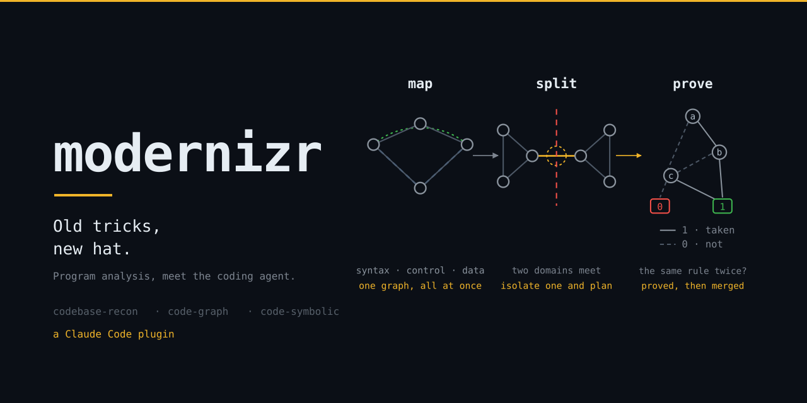

# ani-skills

A Claude Code plugin marketplace. One plugin covers one domain, and each plugin carries its own skills.

## [modernizr](./plugins/modernizr)



**An agent reads files. Some questions are not in any file.**

- Is this method *genuinely* unused?
- Which modules are really coupled?
- Where can this system split?
- Can this business rule ever fire?

Those answers live between files, or in the XML, SQL and templates that are not code at all.

So: build a code property graph once, then point 1970s tooling at it.

- **Graph algorithms** → where the domains divide, so you plan around a real boundary.
- **Formal proof and computer algebra** → when two rules are the same rule, when a threshold is already implied, what the merged form is.

The agent decides what to ask and what the answer means.

Some of it is deliberately unorthodox:

- Compile the JSP pages → the presentation layer becomes ordinary methods in the graph.
- Read a framework's bytecode → what its config attributes do.
- Replay the migrations → a schema that no file holds.

The move is always the same: find something that already knows the answer, and get it into the graph.

### Three skills, by the shape of the answer you need

| Skill | You need | The answer looks like |
|---|---|---|
| [codebase-recon](./skills/codebase-recon/SKILL.md) | to **locate or enumerate** — what does this do, what calls it, what is dead, what does the config actually wire | a list of methods, files and lines |
| [code-graph](./skills/code-graph/SKILL.md) | to **split or isolate** — where the domains actually divide, how small the interface between them is, what you can plan around | a boundary you can isolate one side of |
| [code-symbolic](./skills/code-symbolic/SKILL.md) | to **prove and simplify** — are these two rules the same rule, is this threshold already implied, can these be merged | a proof, and the merged form |

Start with `codebase-recon`. It:

- builds a code property graph worth trusting
- joins that graph to the XML, SQL, properties and templates the graph cannot see
- tells you, as often as not, that a CPG is the wrong tool and ripgrep already answers your question

The other two skills read its exports.

The plugin also ships **hooks**. They:

- block a `curl` to the Joern server, which silently answers about a different codebase
- advise on several trap-shaped queries

## Install

```
/plugin marketplace add aniruddha-adhikary/skills
/plugin install modernizr@ani-skills
```

That installs all three skills and the hooks.

For local development, symlink every skill into `~/.claude/skills`:

```bash
./scripts/link-skills.sh
```

- each entry is a symlink into this repo, so a `git pull` keeps installed skills current
- re-run it after you add or rename a skill

### What the skills expect on your machine

Nothing, to read them. To run them:

| For | You need |
|---|---|
| building and querying a graph | [Joern](https://docs.joern.io/installation) and a JDK |
| resolving dependencies first — **do this**, it decides whether your answers are real | Maven, or the jars by any other route |
| type-checked query authoring (optional) | Coursier, scala-cli, Metals |
| `code-graph` | Python and networkx |
| `code-symbolic` | Python, `z3-solver`, `sympy`, `dd` |
| merging generated code into the graph (optional) | the generator your project uses. The bundled JSP example gets Jasper with Coursier |

## Repo conventions

See [CLAUDE.md](./CLAUDE.md), also readable as `AGENTS.md`. The short version:

- skills stay thin, and route to reference files
- syntax comes from the tool, not from a copy inside the skill
- a pattern ships only after somebody measured it on a real codebase, where it beat both ripgrep and plain reading

Two rules the content follows, both learned the hard way:

- **A number belongs in a skill only if you act on its magnitude** — a threshold, a parameter.
  Otherwise give the mechanism: "a container is a registry, not a restriction" beats the percentage that proved it.
- **Measured negatives are content.** Betweenness centrality, community detection and MC/DC measurably fail on real code.
  Knowing that saves more time than any capability, so the skills document it as carefully as what works.
